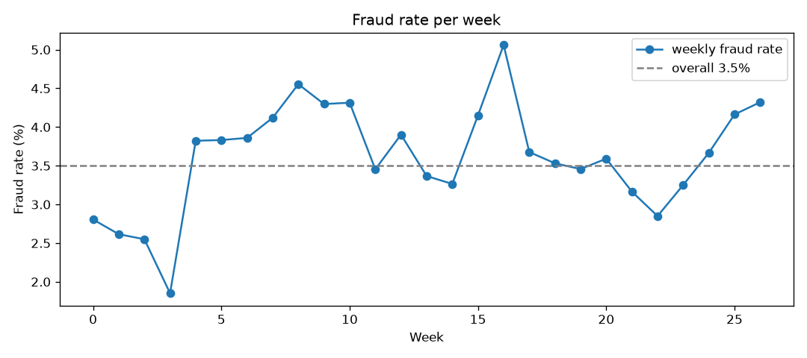
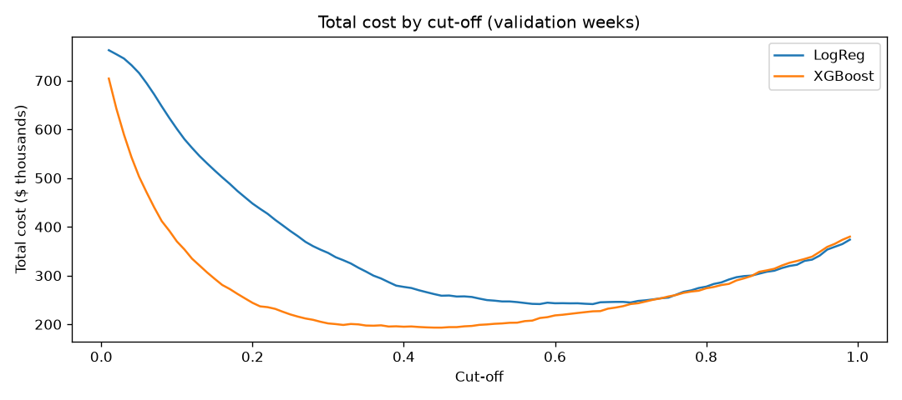

# FraudShield AI

Fraud detection and risk scoring on the IEEE-CIS Fraud Detection dataset.
Portfolio project, not connected to any real bank.

## The problem

Say someone's card details get stolen on a Sunday night. By Monday morning there are six online orders on it: headphones, a gift card, two phone chargers, and some more gift cards. None of them were made by the card owner. The shop ships the goods, the bank refunds the owner, and somebody has to pay for all of it.

Now flip it around. A college student orders a laptop at 2 am, the first big purchase they have ever made with their card. The payment gets blocked because it "looks unusual". They have to call the bank, wait on hold, and the sale might be lost.

Both of these are mistakes. The first one is a **missed fraud**, and it costs the full amount of the order. The second one is a **false alarm**: a genuine customer gets stopped, and someone has to spend time reviewing the alert.

Nobody can check every payment by hand. What I want to build is a system that gives each transaction a risk score and sends only the riskiest ones to a fraud analyst. The aim is not just "catch as much fraud as possible". It is to catch the fraud that costs the most money, without burying the analyst in false alarms.

So I measure the model the way a fraud team would think about it:

- how much fraud **money** it catches, not just how many fraud transactions
- how many of the top 50 or 100 alerts are really fraud, because an analyst can only review so many in a day
- the total cost of a review threshold: missed fraud costs its amount, and every alert costs a fixed review cost

## What I found in the data so far

The data is about 590,000 real e-commerce transactions over roughly 6 months, and only 3.5% of them are fraud.

- Transactions with device information are about 4 times more likely to be fraud (7.96%) than those without (2.10%).
- Fraud payments are only slightly larger than genuine ones (median $75 vs $68.50), so the amount alone is a weak clue.
- Product type C has 11.7% fraud. It is only 12% of transactions but holds about 39% of all fraud.
- Credit cards have 6.7% fraud against 2.4% for debit cards.
- outlook.com (9.5%) and hotmail.com (5.3%) email addresses are riskier, while att.net (0.7%) is very safe.

Fraud is not steady over time. It is lowest in the first few weeks and moves between about 3% and 5% after that, so I split the data by time and check the fraud rate in each part.



## How I built the model

1. **Split by time, not at random.** Train on weeks 0-17, tune on weeks 18-21 (validation), and keep weeks 22-26 (test) locked until the very end. A bank trains on the past and has to catch fraud in the future, so the test should look like the future.
2. **Cleaned the data, learning only from train.** Dropped 12 columns that were more than 90% empty. For Logistic Regression: filled gaps with the median, added "was missing" flags (missing device info is itself a fraud clue), one-hot encoded text columns and scaled the numbers.
3. **Baseline: Logistic Regression** with class weights, because only 3.5% of payments are fraud.
4. **Challenger: XGBoost** with native categories, `scale_pos_weight` and early stopping on validation.
5. **Chose the cut-off by cost, not 0.5.** Total cost = the amount of every fraud let through + $10 of review time for every alert. I tried every cut-off from 0.01 to 0.99 for both models and picked the cheapest.



## Results

**Model choice (validation weeks), each model at its own cheapest cut-off:**

| | Logistic Regression | XGBoost |
|---|---|---|
| PR-AUC | 0.378 | **0.522** |
| best cut-off | 0.65 | **0.45** |
| total cost | $241,492 | **$193,196** |
| fraud money caught | 58% | **68%** |
| alerts | 7,199 | **6,503** |
| real fraud in the top 100 alerts | 95% | **99%** |

XGBoost wins on every count: cheaper, fewer alerts and more fraud money caught.

**Final result: XGBoost at cut-off 0.45 on the test weeks (82,325 payments, scored once):**

| Measure | Result |
|---|---|
| PR-AUC | **0.452** (a random guess scores 0.035, so about 13x better) |
| fraud money caught | **66%** |
| frauds caught (recall) | 64% |
| alerts that are real fraud (precision) | 24% |
| real fraud in the top 100 alerts | **95%** |
| alerts sent to review | 7,482 (9% of payments) |

Letting everything through would have lost about **$441,000** to fraud in these five weeks. With the model the total cost (missed fraud + review time) is **$224,306**, so it **cuts the cost roughly in half**.

The test PR-AUC (0.452) is lower than validation (0.522). That's expected: validation was used to choose when to stop training and where to put the cut-off, and the test weeks are further in the future, where fraud patterns have drifted. That's why the test set stayed locked until the end.

**Limits I know about:**
- the $10 review cost is an assumption; a higher cost for annoying genuine customers would move the cut-off up
- the cut-off was chosen on only four validation weeks
- the most important features are Vesta's anonymous `V` columns, so the model is hard to explain in plain words
- there is no "how unusual is this amount for this card" feature yet, which would help with big but genuine purchases

## Serving the model (FastAPI)

The notebook is where I explored. To use the model outside it, I split the final steps into three files, each with one job:

| File | Job | When it runs |
|---|---|---|
| `src/train.py` | trains XGBoost the same way as the notebook and saves it | once |
| `src/predict.py` | loads the saved model, prepares one payment exactly like the training data, scores it | every payment |
| `src/api.py` | FastAPI service so other programs can send a payment and get an answer | always on |

`train.py` saves one file, `models/fraud_model.joblib`. It holds the model plus everything needed to prepare a new payment the same way as in training: the column order, the category lists learned from train, and the 0.45 cut-off. The retrained model reaches validation PR-AUC 0.521 (best at tree 352), matching the notebook's 0.522.

The API has two endpoints:
- `GET /health`: checks the service is up and the model file loads
- `POST /predict`: takes a payment and returns an `id`, `fraud_score`, `decision` (`review` if the score is 0.45 or higher, otherwise `allow`) and `cutoff`
- `GET /history`: the most recent scored payments, newest first (`?limit=` up to 500)

Only `TransactionAmt` is required. Any other dataset column can be sent too, and anything left out counts as missing. A request without an amount is rejected before it reaches the model.

To run it yourself (with the data in `data/raw/`):

```
uv run python -m src.train
uv run uvicorn src.api:app --reload
```

Then open http://127.0.0.1:8000/docs to try a payment in the browser.

**One thing I learned testing it:** a $500 product C payment with a credit card, an outlook.com email and a mobile device scored only 2.5%, even though each of those clues is risky. I had sent 5 fields and left 400+ blank, including the `C` and `V` columns the model leans on most. A model is only as good as the data it gets at prediction time; in a real bank every payment would arrive with all its columns.

## Saving every decision (SQLite)

A fraud team needs to look back at what the system decided, so every scored payment is saved in a SQLite database (`data/predictions.db`, created on first use). SQLite is a whole database in one file and comes built into Python, so there is no server to set up. `src/db.py` stores the time, amount, product, fraud score and decision of each payment, and `/history` reads them back.

## Tests

Instead of clicking through `/docs` after every change, 7 automatic checks in `tests/test_api.py` prove the service still works:

| Test | What it checks |
|---|---|
| health | `/health` answers `ok` |
| score and decision | the score is between 0 and 1 and the decision is `allow` or `review` |
| cut-off | the decision follows the 0.45 cut-off |
| missing amount | a payment without `TransactionAmt` is rejected (422) |
| text amount | an amount like `"hello"` is rejected (422) |
| unseen category | an email domain the model never saw does not crash it |
| history | scored payments are saved, newest first |

Each test uses its own empty database, so the real history is never touched. Run them with (after training the model once):

```
uv run pytest
```

All 7 pass.

## Plan

- [x] Week 1: data and EDA → time-based split → Logistic Regression baseline → XGBoost → cost-based cut-off → final test
- [x] Week 2, Day 8: save the model + FastAPI service
- [x] Week 2, Day 9: SQLite history + automatic tests
- [ ] Week 2: Streamlit dashboard → Docker → Cloud Run → demo video

Upgrade after the core: Firestore and Pub/Sub replay, and a PyTorch neural network as a third model.

The full work is in [`notebooks/01_eda.ipynb`](notebooks/01_eda.ipynb) and [`notebooks/02_split_and_features.ipynb`](notebooks/02_split_and_features.ipynb).

## Data

The data is not in this repo (Kaggle competition rules). To get it:

1. Join the competition and accept the rules: https://www.kaggle.com/competitions/ieee-fraud-detection/rules
2. Put your Kaggle API token in `~/.kaggle/` (kaggle.com → Settings → API).
3. Run:

```
uv run kaggle competitions download -c ieee-fraud-detection -p data/raw
```

Then unzip into `data/raw/`.
